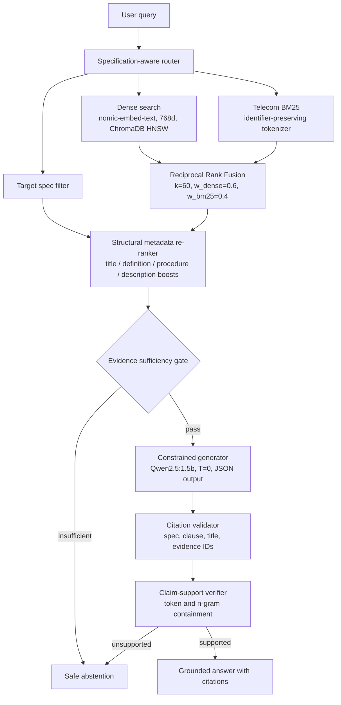

<div align="center">

# 3GPP-Grounded-RAG

**Citation-grounded RAG for 3GPP 5G specifications, with deterministic claim verification and safe abstention.**

[](https://www.python.org/)
[](https://fastapi.tiangolo.com/)
[](https://www.trychroma.com/)
[](https://ollama.ai/)
[](https://streamlit.io/)
[](tests/)

[Results](#-results) · [Architecture](#-architecture) · [Quickstart](#-quickstart) · [API](#-api) · [Limitations](#-limitations--failure-analysis)

</div>

---

## TL;DR

- Fully **local and private**: Ollama (`qwen2.5:1.5b`, `nomic-embed-text`) + ChromaDB, no external APIs.
- **Clause-aware ingestion** of 5 Release 18 specs → **6,737 chunks** with hierarchical breadcrumbs and Markdown tables.
- **Hybrid retrieval** (dense + telecom-tuned BM25 + RRF) with **specification-aware routing** and **structural re-ranking**: **Hit@5 = 100%** (21 queries), **MRR 0.80**.
- **Three verification gates** (evidence sufficiency, citation validation, claim support) → **0 unsupported claims** and **8/8 correct abstentions** on the evaluation set.
- Production-style packaging: FastAPI, Pydantic v2, Streamlit UI, **90 automated tests**.

---

## Why this exists

Telecom engineers work from 3GPP specs spanning thousands of dense pages. A wrong timer value or procedure step can cause real implementation faults, so "plausible" is not good enough. Off-the-shelf RAG fails here for four reasons:

| Problem | Why generic RAG breaks | What this project does |
| :--- | :--- | :--- |
| **Destructive chunking** | Fixed-size chunks split clauses like `§4.2.8.0` and tables, losing headers | Clause-aware chunking with breadcrumbs (`4 > 4.2 > 4.2.8 > 4.2.8.0`) and table preservation |
| **Identifier blindness** | Tokenizers split `5G-GUTI`, `Npcf_SMPolicyControl`, `4.2.8.0` | Custom BM25 regex tokenizer that keeps technical identifiers intact |
| **Specification dominance** | Big specs (TS 23.501/23.502) drown out small ones (TS 28.535, 39 chunks) | Specification-aware router steers the candidate pool |
| **Hallucination risk** | LLMs invent parameters and steps | Evidence gate → citation validator → claim verifier → abstention |

---

## 📊 Results

> All numbers come from the scripts in [`evaluation/`](evaluation/) and are reproducible. The evaluation sets are small, so treat these as empirical results on these sets, **not universal guarantees**.

### Retrieval (21 authoritative queries)

| Metric | Result |
| :--- | :--- |
| Hit@1 | 66.7% (14/21) |
| Hit@3 | 90.5% (19/21) |
| **Hit@5** | **100% (21/21)** |
| **MRR** | **0.7992** (hybrid baseline: 0.7251) |
| Held-out generalization (6 unseen queries), Hit@5 | 83.3% (5/6) |

### What the full pipeline adds over plain hybrid search

| Configuration | MRR |
| :--- | :---: |
| Dense + BM25 via RRF (baseline) | 0.7251 |
| + Specification-aware routing + structural re-ranking (**final**) | **0.7992** |

Routing and re-ranking lift MRR by about 10% relative (+0.074) over the plain hybrid baseline.

### Grounded generation (30 queries: 22 answerable, 8 adversarial/unanswerable)

| Metric | Result | Denominator |
| :--- | :--- | :--- |
| Citation validity | 100% | 20/20 answers produced |
| Citation completeness | 100% | spec + clause number + title present |
| Claim support rate | 100% | 15/15 verified claims |
| Unsupported claim rate | 0% | 0/15 claims |
| Abstention accuracy | 100% | 8/8 adversarial queries |
| False answer rate | 0% | 0/8 |
| Answer correctness (answerable) | 63.6% | 14/22, with a 1.5B local model |

**How to read this:** the verification gates make the system *safe* (nothing unsupported gets through), while *correctness* is bounded by the small generator and by cautious abstention on hard multi-step questions. A larger model is the main lever for improving it.

---

## 🏗 Architecture



### Key design decisions

| Decision | Rationale | Trade-off |
| :--- | :--- | :--- |
| Custom BM25 instead of a library | Needed a tokenizer that preserves `5G-GUTI`, `S-NSSAI`, `4.2.8.0` | More code to maintain |
| RRF over score fusion | Dense and BM25 scores aren't comparable; rank fusion is robust | Discards score magnitude |
| Deterministic verifier over LLM-as-judge | Reproducible, zero extra latency/cost, auditable | May reject valid paraphrases (favors safety over recall) |
| `T=0.0` + structured JSON with evidence IDs | Each claim maps to a checkable evidence chunk | Small models sometimes emit malformed JSON → abstain |
| Local-only inference | Privacy for proprietary telecom work | CPU latency of 40–110 s/query |

---

## 📚 Corpus & Ingestion

| Spec | Version | Title | Chunks |
| :--- | :--- | :--- | ---: |
| TS 23.501 | V18.12.0 | System Architecture for the 5G System | 1,437 |
| TS 23.502 | V18.14.0 | Procedures for the 5G System | 1,719 |
| TS 24.501 | V18.13.0 | NAS protocol for 5GS | 2,968 |
| TS 28.535 | V18.2.0 | Management & orchestration; closed control loop assurance | 39 |
| TS 38.300 | V18.10.0 | NR; NG-RAN Overall Description | 574 |
| **Total** | | 48,844 paragraphs · 3,294 clauses · 673 tables | **6,737** |

- **Hierarchical clause extraction** across all heading levels and annexes, with persistent breadcrumb trails.
- **Table preservation**: 673 technical tables converted to column-aligned Markdown; layout/cover tables skipped.
- **Boilerplate stripping**: 4,325 TOC paragraphs, page fields, headers/footers and legal notices removed to avoid index contamination.
- **Semantic boundary chunking**: clauses over 2,000 chars split on paragraph boundaries, with clause ID and breadcrumb prepended to every sub-chunk.

---

## 🔎 Retrieval Details

**Hybrid fusion:** Reciprocal Rank Fusion over dense and BM25 rankings, with `k=60`, `w_dense=0.6`, `w_bm25=0.4`. Each chunk's score is the weighted sum of `1 / (k + rank)` across both retrievers.

**Structural re-ranking** (candidate pool = max(30, 4 × top_k)):

| Signal | Boost |
| :--- | :---: |
| Clause title matches query keywords | 1.30× |
| Definition intent → Clause 3 / 3.1 | 1.45× |
| Procedure intent → Stage-2 sections in TS 23.502 | 1.35× |
| Description intent → architectural overview sections | 1.25× |

**Routing:** explicit (`"in TS 28.535"`) and implicit (`"Closed control loop"` → TS 28.535, `"NG-RAN"` → TS 38.300, `"NAS"` → TS 24.501) detection.

---

## 🛡 Grounding & Safe Abstention

1. **Evidence sufficiency gate**: abstain before generation if retrieval is empty or weak.
2. **Citation validator**: every cited evidence ID must exist in the prompt context, and spec / clause number / title must match.
3. **Claim-support verifier**: substantive n-grams and technical terms in each claim must be contained in the cited chunk.
4. **Abstention policy**: out-of-scope (IEEE 802.11, Kubernetes), adversarial/nonexistent premises (7G teleportation), or unsupported claims → `status: "abstain"`.

---

## 🚀 Quickstart

**Prerequisites:** Python 3.10+ and [Ollama](https://ollama.ai/) running locally.

```bash
# 1. Models
ollama pull nomic-embed-text:latest
ollama pull qwen2.5:1.5b

# 2. Install
git clone https://github.com/Dipakk7/3gpp-grounded-rag.git
cd 3gpp-grounded-rag
python -m venv .venv
source .venv/bin/activate          # Windows: .\.venv\Scripts\Activate.ps1
pip install -r requirements.txt
cp .env.example .env

# 3. Run API (http://localhost:8000/docs)
uvicorn api.main:app --port 8000 --reload

# 4. Run UI (new terminal, http://localhost:8501)
streamlit run streamlit_app.py
```

Processed chunks and indices ship with the repo. To rebuild from raw `.docx`:

```bash
python ingestion/ingest.py && python retrieval/index_corpus.py
```

### Reproducing results

```bash
pytest -v                                                    # 90 tests: API, ingestion, retrieval, routing, generation, UI
python evaluation/retrieval/run_evaluation.py                # 21-query retrieval benchmark
python evaluation/generation/run_generation_evaluation.py    # 30-query generation benchmark
```

---

## 🔌 API

| Endpoint | Description |
| :--- | :--- |
| `GET /health` | Readiness of vector store, BM25 index, and models |
| `GET /metadata` | Indexed specs, chunk counts, model configuration |
| `POST /ask` | Full grounded QA pipeline (`question`, `top_k`) → `answered` or `abstain` with citations, evidence, and latency breakdown |

```bash
curl -X POST http://localhost:8000/ask \
  -H "Content-Type: application/json" \
  -d '{"question": "What is the NG User Plane (NG-U) interface defined between in NG-RAN?", "top_k": 5}'
```

<details>
<summary>Answered response</summary>

```json
{
  "status": "answered",
  "answer": "The NG User Plane (NG-U) interface is defined between the NG-RAN node and the UPF [TS 38.300, Clause 4.3.1.1 — NG User Plane].",
  "citations": [
    {
      "specification": "TS 38.300",
      "version": "V18.10.0",
      "clause_number": "4.3.1.1",
      "clause_title": "NG User Plane"
    }
  ],
  "latency_breakdown": { "retrieval_ms": 1845.2, "generation_ms": 42100.5, "total_ms": 43945.7 }
}
```
</details>

<details>
<summary>Safe abstention response</summary>

```json
{
  "status": "abstain",
  "answer": null,
  "citations": [],
  "reason": "The question cannot be answered from the provided 3GPP specifications or contains adversarial premises.",
  "latency_breakdown": { "retrieval_ms": 1210.4, "generation_ms": 0.0, "total_ms": 1210.4 }
}
```
</details>

---

## ⚠️ Limitations & Failure Analysis

1. **Latency:** `qwen2.5:1.5b` on CPU takes ~40–110 s/query (generation dominates; retrieval is ~1–2 s).
2. **Small-model ceiling:** multi-spec procedural questions can yield malformed JSON → safe abstention. Correctness on answerable queries is 63.6%.
3. **Small eval sets:** 21 / 6 / 30 queries. Results are indicative, not statistically conclusive.
4. **Conservative verifier:** token containment can reject valid paraphrases (precision over recall).
5. **Static corpus:** 5 specs only; references to unindexed specs (e.g. TS 33.501) can't be resolved.

---

## 📁 Project Structure

<details>
<summary>Expand</summary>

```
3gpp-grounded-rag/
├── api/            # FastAPI app: main, routes, models, service, dependencies
├── generation/     # generator, citation_validator, claim_verifier, evidence_gate, abstention, pipeline
├── ingestion/      # docx_parser, chunker, table_parser, ingest, models
├── retrieval/      # retriever (dense + hybrid), bm25, router, vector_store, embedding, index_corpus
├── evaluation/     # retrieval/ and generation/ datasets, runners, results
├── data/           # raw/, processed/, vectorstore/
├── docs/           # architecture + validation reports
├── scripts/        # QA and smoke tests
├── tests/          # 90 automated tests
├── streamlit_app.py
├── requirements.txt
└── .env.example
```
</details>

Deep dives: [`retrieval_architecture.md`](docs/retrieval_architecture.md) · [`generation_architecture.md`](docs/generation_architecture.md) · [`retrieval_benchmark_v2_report.md`](docs/retrieval_benchmark_v2_report.md) · [`generation_evaluation_report.md`](docs/generation_evaluation_report.md)

---

<div align="center">

**Built by [Dipak Khandagale](https://dipakkhandagale.vercel.app)** · [GitHub](https://github.com/Dipakk7)

</div>
